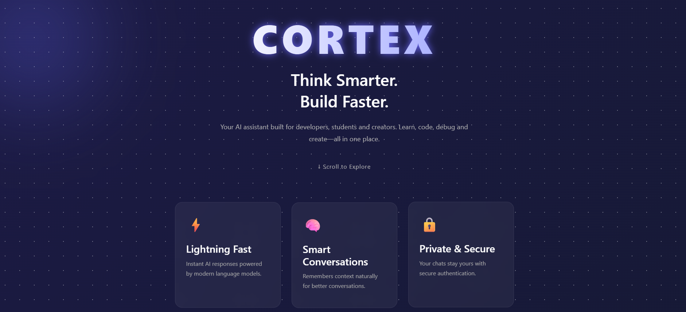
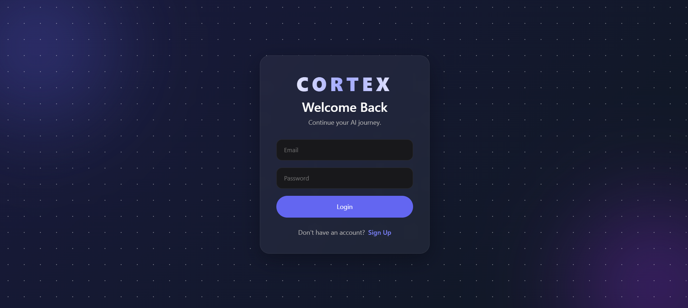
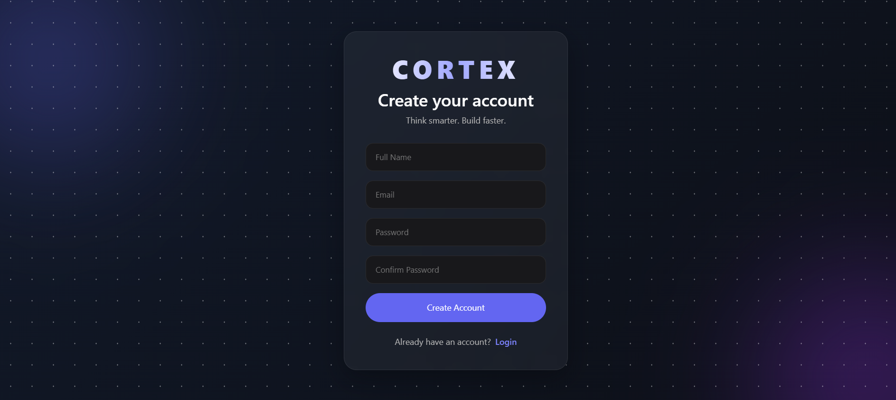
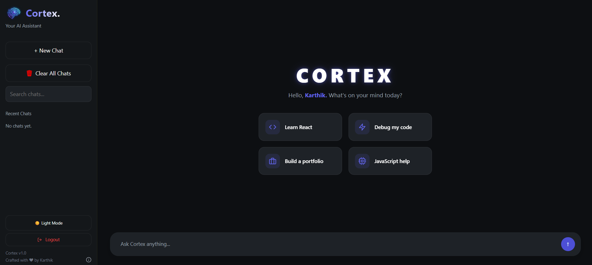
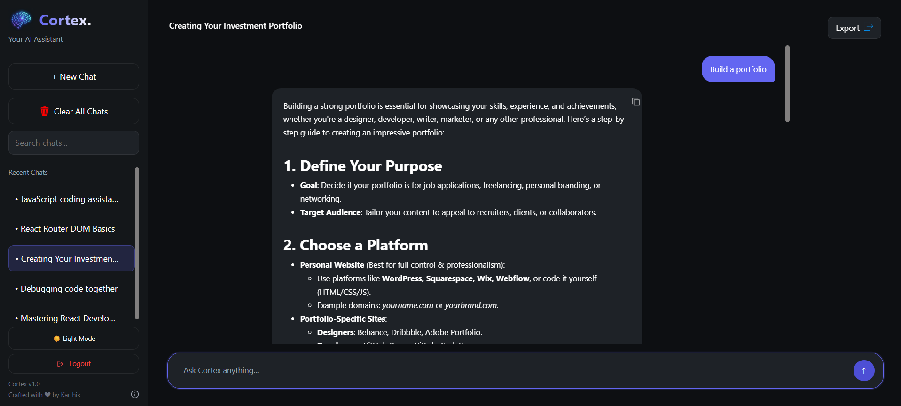

# 🧠 Cortex - AI Powered MERN Chat Application

<p align="center">
  
</p>

<p align="center">


</p>

<p align="center">


</p>

<p align="center">

A modern AI-powered full-stack chat application built using the MERN Stack that enables users to securely authenticate, chat with AI, and manage conversation history through a clean, responsive interface.

</p>

---

# 🚀 Live Demo

### 🌐 Live Application

👉 https://cortex-22tk.vercel.app

### ⚙️ Backend API

👉 https://cortex-backend-novl.onrender.com

---

# 📖 About

Cortex is an AI-powered MERN chat application designed to provide users with an intuitive conversational experience.

The application features secure authentication, persistent chat history, AI integration through the OpenRouter API, and cloud deployment using modern development practices.

This project demonstrates real-world full-stack development skills including:

- Frontend Development
- Backend API Development
- REST API Integration
- JWT Authentication
- MongoDB Atlas Integration
- Cloud Deployment
- Production Debugging
- Git & GitHub Workflow

---

# 🛠 Built With

- React.js
- Vite
- Node.js
- Express.js
- MongoDB Atlas
- Mongoose
- JWT Authentication
- Bootstrap
- Axios
- OpenRouter API
- Vercel
- Render

---

# ✨ Features

- 🔐 Secure JWT Authentication
- 👤 User Signup & Login
- 🔒 Password Hashing using bcrypt
- 🤖 AI Chat powered by OpenRouter API
- 💬 Persistent Chat History
- 🗑️ Delete Conversations
- 🛡️ Protected Routes
- ⚡ RESTful APIs
- ☁️ MongoDB Atlas Cloud Database
- 📱 Fully Responsive Design
- 🚀 Cloud Deployment
- 🎨 Modern User Interface

---

# 🛠 Tech Stack

## Frontend

- React.js
- Vite
- React Router DOM
- Axios
- Bootstrap
- CSS3

---

## Backend

- Node.js
- Express.js
- MongoDB Atlas
- Mongoose
- JWT
- bcrypt
- CORS
- dotenv

---

## AI

- OpenRouter API

---

## Deployment

- Vercel
- Render

---

# 🏗 Architecture

```text
                 React Frontend
                      │
                      │
               Axios HTTP Requests
                      │
                      ▼
              Express.js Backend
                      │
       ┌──────────────┴──────────────┐
       │                             │
       ▼                             ▼
MongoDB Atlas                 OpenRouter API
(Database)                    (AI Responses)
```

---

# 📸 Screenshots

## 🏠 Landing Page


---

## 🔐 Login



---

## 📝 Signup



---

## 💬 Dashboard



---

## 🤖 AI Chat



---

# 📂 Folder Structure

```text
Cortex
│
├── Backend
│   ├── config
│   ├── middleware
│   ├── models
│   ├── routes
│   ├── .env.example
│   ├── package.json
│   └── server.js
│
├── Frontend
│   ├── public
│   ├── src
│   ├── .env.example
│   ├── package.json
│   └── vite.config.js
│
├── screenshots
│   ├── landing-page.png
│   ├── login.png
│   ├── signup.png
│   ├── home.png
│   └── ai-chat.png
│
├── README.md
├── LICENSE
└── .gitignore
```

---

# 📋 Prerequisites

Before running the project, make sure you have:

- Node.js (v22 or later recommended)
- npm
- MongoDB Atlas Account
- OpenRouter API Key
- Git

---

# ⚙️ Installation

## Clone Repository

```bash
git clone https://github.com/skyadav227/Cortex.git
```

---

## Navigate to Project

```bash
cd Cortex
```

---

## Install Frontend

```bash
cd Frontend
npm install
npm run dev
```

---

## Install Backend

```bash
cd Backend
npm install
npm run dev
```

---

# 🔑 Environment Variables

This project uses environment variables for configuration.

Before running the application, copy the example files:

```text
Backend/.env.example  →  Backend/.env
Frontend/.env.example →  Frontend/.env
```

Update the `.env` files with your own credentials before starting the application.

> **Note:** The `.env.example` files are included for reference only and do not contain any sensitive information.

---

# 🌍 Deployment

| Service | Platform |
|----------|----------|
| Frontend | Vercel |
| Backend | Render |
| Database | MongoDB Atlas |
| AI | OpenRouter |

---

# 📡 API Endpoints

| Method | Endpoint | Description |
|---------|----------|-------------|
| POST | `/auth/signup` | Register a new user |
| POST | `/auth/login` | Login user |
| GET | `/chats` | Fetch all chats |
| POST | `/chats` | Create a new chat |
| DELETE | `/chats/:id` | Delete a conversation |
| POST | `/api/ai` | Generate AI response |

---

# 🚀 Future Improvements

- 🌙 Dark / Light Theme
- 👤 User Profile
- 🖼 Image Uploads
- 📎 File Sharing
- 🔍 Chat Search
- ⚡ Real-time Messaging (Socket.IO)
- 📥 Export Conversations
- 🌍 Multi-language Support
- 📊 Analytics Dashboard
- 🐳 Docker Support

---

# 💡 Key Learnings

While building Cortex, I gained hands-on experience with:

- React Component Architecture
- React Router
- JWT Authentication
- Password Hashing using bcrypt
- REST API Development
- MongoDB Atlas
- Mongoose ODM
- Express Middleware
- API Integration
- Environment Variables
- Cloud Deployment
- CORS Configuration
- Production Debugging
- Git & GitHub Workflow

---

# 🤝 Contributing

Contributions, issues, and feature requests are welcome!

If you'd like to contribute:

1. Fork the repository
2. Create a new feature branch
3. Commit your changes
4. Push your branch
5. Open a Pull Request

---

# 👨‍💻 Author

## Karthik Yadav

GitHub: https://github.com/skyadav227

---

# ⭐ Show Your Support

If you found this project useful or interesting,

⭐ Star this repository.

It motivates me to build more awesome projects!

---

# 📄 License

This project is licensed under the MIT License. Feel free to use, modify, and distribute it in accordance with the license terms.

---

<p align="center">

Made with ❤️ by <b>Karthik</b>

</p>